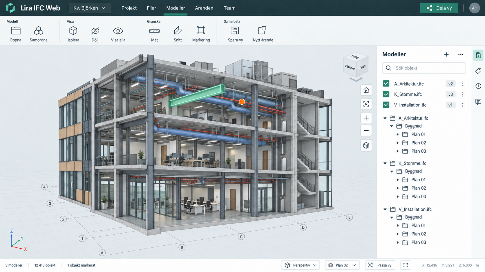

# LiraIFC viewerspecifikation

Uppdaterad 13 oktober 2026. LiraIFC är en lokal IFC-viewer med LiraStructureWebs formspråk och modellgranskning inspirerad av Trimble Connect. Nuvarande omfattning är enbart visning och granskning. Samarbete, inloggning, ärenden, delning och molnlagring ingår inte.

## Arbetsytan

Toppfältet är 54 px högt i petrol `#192f35`. Under det ligger Liras ljusa kommandoband med grupperna Modell, Urval, Granska, Utseende och Vyer. 3D-modellen får hela den återstående ytan till vänster om högerinspektorn.

Modeller ligger i högerinspektorn som en egen flik. Flikarna är Modeller, Egenskaper, Sparade vyer och Granska. En panel visas åt gången. Panelbyte behåller kamera, objekturval och synlighet. På mindre skärmar kan inspektorn fällas undan.

| Del | Utformning |
| --- | --- |
| Typografi | Inter med systemfont som reserv |
| Kommandoband | 124 px på desktop, komprimerat på mindre skärmar |
| Text | `#253e48`, sekundär text i dämpad gråblå ton |
| Accent | Grön `#287c65`, markerat läge `#dbece6` |
| Arbetsyta | Ljusgrå `#e9eef0`, vita paneler |
| Ramar | Tunna linjer `#d3dcdf`, 4–6 px hörnradie |
| Högerinspektor | Cirka 340 px inklusive 40 px vertikal ikonlist |
| Statusrad | 44 px, modellantal, objektantal, urval och vykontroller |

Stilreferenser är LiraStructureWebs `src/lira-shell.css`, `src/ui/workspace.css` och `src/model/ui/model-chrome.css`.

## Viewerns funktioner

| Område | Funktion |
| --- | --- |
| Öppna modeller | Flera IFC-filer genom filväljare eller drag och släpp |
| IFC-import | Separat worker, status under bearbetning och begripligt importfel |
| Modellträd | Modellens faktiska IFC-hierarki, exempelvis projekt, site, byggnad, våning och utrymme. Tänd/släck efter modell- och grennamn styr alla underliggande objekt och visar delvis synliga grenar. Ingen separat modellista ovanför trädet |
| Indelning | Väljare för IFC-struktur, System, Zoner och Objekttyper. Samma objektsynlighet och urval gäller i samtliga indelningar |
| Sökning | Namn, IFC-klass, GlobalId och våning; separat filter för objekttyp |
| Navigering | LiraStructureWebs musgester: mitten/högerdrag panorerar, Shift/Ctrl/Cmd + mitten/högerdrag ger orbit runt träffad modellpunkt och scroll zoomar mot pekaren. Vänsterklick väljer objekt. Mus/styrplatta väljs i inställningsfönstret |
| Navigationsinställningar | Zoomhastighet 25–400 % i steg om 5 %, återställning till 100 %, inverterad scrollzoom samt orbit-dämpning av/på. Sparas lokalt och gäller direkt. Nypning påverkas inte av inverteringen |
| Projektion | Perspektiv och ortografisk projektion; topp-, fram-, sido- och isometrisk vy |
| Urval | Klick, flerval med Shift/Ctrl/Cmd + klick. Högerklick i modellen eller på en objektrad i modellträdet öppnar Info, Fokusera, Visa, Göm och Isolera för hela urvalet. Högerdrag fortsätter att panorera. Markering behåller aktuell inspektorflik; Info öppnar egenskaper. Klick på grennamnet markerar grenen; Shift + klick lägger till eller tar bort grenar. Högerklick på en markerad gren gäller unionen av alla markerade grenar utan dubbla objekt, även för överlappande system och zoner. Trädets pil fäller ut eller ihop grenen. Högerklick på våning, gren eller modellrot markerar alla grenens objekt, oberoende av sökfilter, och erbjuder Fokusera, Visa, Göm och Isolera. Isolera återvisar även tidigare dolda objekt i grenen. Ingen hovertext vid pekaren, flytande objektpanel eller rubrik över modellvyn |
| Egenskaper | IFC-identitet, attribut, property sets, material och typdefinitioner när filen innehåller dem |
| Utseende | Originalfärger, disciplinfärger, färg efter IFC-klass, kantlinjer och rutnät |
| Snitt | Snittplan i X/Y/Z med läge och vänd riktning; snittbox med sex gränser. Slutna, opaka volymer får fyllda och skrafferade snittytor |
| Mätning | Punktavstånd i meter, snap till hörn på träffad triangel och redovisning av axelavstånd |
| Sparade vyer | Kamera, projektion, snitt, modellidentiteter och synlighet |
| Skärmbilder | Export av den aktuella 3D-vyn som PNG |
| Lokal lagring | IFC-filer i IndexedDB, vyer och inställningar i localStorage |
| Demo | Märkt byggnadsmodell med arkitektur, stomme och installationer |

Filerna stannar på användarens enhet. Modeller i samma session delar renderingsorigo. Originalets placering används och ett gemensamt origo dras bort i dubbel precision innan koordinaterna skrivs till GPU-geometrin. Viewern renderar i meter och använder Y som höjdaxel.

## Tekniskt genomförande

Webbklienten använder Vite och JavaScript. Three.js äger rendering, kamera, raycasting och klippning. web-ifc läser IFC i en worker och behåller modellen där för egenskapsförfrågningar. Geometri grupperas i renderingsbatcher med objektintervall så att objektval och synlighet fungerar utan en separat draw call för varje IFC-objekt.

Objektidentiteten består av modellens identitet och IFC-objektets Express ID. GlobalId visas som IFC-identitet. Sparade vyer är bundna till de ursprungliga lokala modellidentiteterna och får inte återställas mot andra filer enbart därför att filnamnen matchar.

Vid borttagning av en modell avslutas dess worker och geometrins GPU-resurser frigörs. Vyer som refererar till den borttagna modellen markeras som otillgängliga. Webbläsarens webbplatsdata är den lokala lagringsgränsen; om den rensas försvinner modellerna och vyerna.

## Verifieringskrav

- En verklig IFC-fil ska importeras med rätt objektidentitet och enheter.
- Objektval i modellen och modellträdet ska ge rätt egenskaper.
- Synlighet och isolering ska påverka både rendering och träfftestning.
- Modeller med samma Express ID ska ha olika objektidentiteter.
- Mätning ska redovisa verkliga modellavstånd i meter.
- Snitt ska klippa modellen utan att ändra dess geometri.
- En sparad vy ska återställa kamera, snitt och synlighet.
- Lokal återöppning ska fungera efter omladdning av sidan.
- Importfel ska visa ett begripligt meddelande och lämna andra öppna modeller användbara.
- Gränssnittet ska fungera på desktop och med inspektorn som utfällbar panel på mobil.

Ett lokalt före/efter-test med en offentlig IFC på 72,9 MB och 1,56 miljoner trianglar finns i [prestandarapporten](performance.md). Träfftest och snappning accelereras med ett BVH-index som behåller objektidentiteter och uppdateras vid ändrad synlighet/placering. Fler produktionsmodeller och Windows/GPU-kombinationer behöver provas innan någon generell modellstorlek eller bildfrekvens utlovas.

## Fortsatt utveckling av viewern

Grundträdet följer filens rumsliga struktur med nodidentiteter från IFC. Nivåer som saknas i filen hittas inte på. Objekt utan koppling till hierarkin visas under Övrigt. Två likadant namngivna våningar i olika byggnader hålls isär. Sökning begränsar vilka rader som visas, men grenens tänd/släck-knapp styr alltid hela grenen.

System, zoner och IFC-klasser visas som alternativa indelningar med samma objektreferenser och synlighetsstyrning. System läses från IfcSystem och dess undertyper, med IfcZone i zonvyn. Zoner läses från IfcZone och IfcSpatialZone. Medlemskap följer explicita IFC-relationer, även via undergrupper, rumsliga noder och objekttyper. Ett objekt kan finnas i flera grupper utan att dess geometri kopieras. Objekt utan tillhörighet finns i en egen gren. Väljaren och grenarnas öppna/stängda lägen behålls när användaren växlar indelning; den valda indelningen sparas lokalt. Indelning efter valfria egenskaper kan tillkomma senare. [buildingSMART om rumslig struktur](https://standards.buildingsmart.org/IFC/RELEASE/IFC4_3/HTML/concepts/Object_Composition/Aggregation/Spatial_Decomposition/content.html) och [grupprelationer](https://standards.buildingsmart.org/IFC/RELEASE/IFC4_3/HTML/lexical/IfcRelAssignsToGroup.htm).

Prioriterade utökningar är mer avancerad geometrisnap, snabbare träfftestning för mycket stora modeller, manuell koordinatkorrigering och förbättrad återställning av vyer när filer byts ut. Dessa är viewerfunktioner och kräver inga samarbetsfunktioner.

IFC2x3 och IFC4 är målformat. Kompatibiliteten beror på den importerade filens geometri och parserns stöd och behöver verifieras med användarens modellmaterial.

## Bildreferens

Det senaste bildförslaget fastställer placeringen av modellträdet och Liras formspråk. Samarbetsknappar som syns i den tidigare konceptbilden ingår inte i implementationen.

## Appuppdateringar

Toppfältets gröna Uppdatera appen visas när versionskontrollen hittar en ny publicerad version. Kontrollen görs vid start, när appen återfår fokus och var 15:e minut. Användaren startar uppdateringen med knappen; inga automatiska omladdningar. En pågående IFC-import måste bli klar först. Kamera, snitt, synlighet, markering och utseende återställs efter omladdningen; modeller och sparade vyer finns kvar i lokal lagring.

Visa i objekt- och grenmenyn återvisar hela markeringen, även under isolering. Om modellen var släckt visas bara markerade objekt eller grenar; modellens övriga objekt förblir dolda.

Högerklick på modellvyns tomma bakgrund öppnar Visa alla, Anpassa modell och Helskärm. Menyn visas även om objekt är markerade, utan att markeringen ändras. Högerdrag fortsätter att panorera. Den tidigare flytande knappstapeln för passning, zoom och helskärm är borttagen; zoom sker med scroll eller nypning.

## Rektangelmarkering

Vänsterdrag i modellvyn startar rektangelmarkering direkt. Vänster till höger visar en blå ruta med heldragen kant och väljer objekt vars återstående geometri är helt innesluten. Höger till vänster visar en grön ruta med streckad kant och väljer objekt vars ytor berör rutan. Shift vid dragstart lägger till utan att avmarkera tidigare urval; utan Shift ersätts urvalet. Ett kort klick behåller vanlig objektmarkering och Shift/Ctrl/Cmd-flerval.

Urvalet använder objektens verkliga trianglar och snittytor, inklusive öppningar, i perspektiv och ortografisk vy. Påslagna objekt bakom andra objekt ingår. Dolda objekt, släckta modeller, geometri utanför kamerans djupområde och bortklippta delar ingår inte. Objekt med flera delar eller renderingsbatcher behandlas som ett gemensamt IFC-objekt. Kameran pausas under dragningen. Esc, förlorat fönsterfokus eller ändrad viewportstorlek avbryter utan att ändra urvalet. Mätverktygets vänstergester behåller sin funktion.

## Installerad app och ikoner

Appmanifestet anger LiraIFC som namn, fristående appfönster och relativ start-URL/scope för GitHub Pages och lokal preview. Windows installationsikoner (32, 44, 48, 64, 128, 192, 256 och 512 px), favicon och Apple-ikonen är exporter från samma public/lira-icon.svg som används i toppfältet. Ingen separat eller alternativ logga används för installationen. Äldre installationer kan behöva läsa in uppdaterad appmetadata för att få rätt ikon.

## Vykub

En kompakt vykub (120 px bred) uppe till höger följer kamerans riktning och vridning. Den visas med 30 % opacitet i viloläge och full opacitet vid hover, tangentbordsfokus eller dragning, med en mjuk övergång. Diskreta etiketter med normal textvikt ligger i sidornas plan och projiceras med kuben, så att de ser tryckta på sidorna ut. Sex sidor ger raka vyer (Topp, Botten, Fram, Bak, Höger, Vänster), tolv fasade kanter ger tvåaxliga diagonala vyer och åtta hörn ger isometriska vyer. Träffytor markeras grönt vid hover och kan aktiveras med Tab följt av Enter eller mellanslag.

Vänsterdrag på kuben roterar kameran runt befintligt rotationscentrum. Pilarna vrider vyn 90° runt siktlinjen och hemknappen återgår till standardvy utan passning eller automatisk zoom. Perspektiv/ortografisk projektion, zoom, kameraavstånd och målpunkt behålls när riktningen ändras. Vybyten animeras i 320 ms; inställningen för reducerad rörelse respekteras. Nya musgester avbryter pågående övergång, och sparade vyer inkluderar kamerans upp-riktning så att vridna vyer kan återställas. Modellmarkering och navigationsgester på huvudcanvas behåller sin funktion.

## Inspektorns flikrad

Pilen ligger överst i flikraden, utanför tablistan. Högerpil fäller ihop panelen till den 40 px breda flikraden; vänsterpil öppnar senast valda panel. Flikval öppnar alltid inspektorn. Canvasens tidigare knapp är borttagen. Samma beteende gäller i smala fönster. Knappens namn och aria-expanded följer panelens läge.

## CAD-referenser (DXF/DWG)

Filväljaren och drag/släpp tar IFC, DXF och DWG, även flera filer i samma import. DWG omvandlas lokalt till en ritningsrepresentation i en separat worker med LibreDWG; ASCII-DXF parsas med dxf-parser. Inga CAD-filer skickas till en extern tjänst. CAD-filer får vara högst 50 MB, med högst 100 000 expanderade ritningsobjekt.

Stödet omfattar linjer, 3D-polylinjer, polylinjer med bulge, cirklar, bågar, text/MTEXT och block med nästlade baspunkter, rotation, OCS, spegling och separata XYZ-skalor. Fyllda ytor stöds som 3DFACE, SOLID/TRACE, polyface, polygonmesh och MESH; även konkava plana meshytor trianguleras. Meshens basgeometri visas utan subdivision/crease-utjämning. Blockens Z-insättning, baspunkt och separata Z-skala bevaras. SOLID/TRACE använder sitt OCS-koordinatsystem. Måttsättningsblock visas när de finns i filen. DWG 3DSOLID konverteras automatiskt från originalfilen med opencadcodec/opencadkernel i samma lokala worker. Mesh kopplas till DXF-strukturen via DWG-handle, så att lager, ByLayer/ByBlock och TrueColor samt varje blockinstans placering bevaras. Rundade ytor använder motorns normaler, och spegling korrigerar triangelordningen. Ofullständiga konverteringar rapporteras i Importanmärkningar och i objektets Info. DXF 3DSOLID, externa referensfiler och övriga entiteter utan stöd återges inte; upptäckta typer utan stöd visas under referensens placering. Paperspace importeras inte.

Ritningens XY-koordinater visas i modellens XZ-plan och Z-koordinaten blir modellhöjd med tillägg för referensens höjdförskjutning. Enhet läses från INSUNITS när den är känd och normaliseras till meter. Saknad eller okänd enhet kräver ett engångsval före placering; appen antar inte längre millimeter. Valet sparas med filen, används även för gemensamt CAD-origo och återställs vid återöppning. Äldre enhetslösa filer vars sparade enhet aldrig bekräftats kontrolleras igen. Gemensamt modellursprung subtraheras före konvertering till GPU-flyttal. Modellträdet visar CAD som IFC: filnamn, tänd/släck och lager/objekt utan placeringsruta. Högerklick på DWG/DXF-filnamnet erbjuder Placering… som öppnar en dialog för enhet, X/Z-förskjutning i meter, höjd och rotation, samt Placera vid modellen för referenser med olika koordinatsystem. Inställningarna sparas automatiskt; Esc eller Stäng återgår till modellträdet. Originalfil och placering lagras i IndexedDB.

CAD-lager ingår i modellträdet och stöder hela grenens flerval, Fokusera, Visa, Göm och Isolera. Enskilda ritningsobjekt kan markeras i vyn/trädet och med rektangel. Linjer använder ett separat linjeindex för träfftest och synlighet; sektioner klipper linjer och ytor utan att skapa snittlock för CAD-meshar. Fyllda ytor stöder markering, tänd/släck, isolering, rektangelmarkering, mätning och valbara kantlinjer. Text visas på texturerade plan och får inga falska kantlinjer runt sina textrutor. Mätning kan snappa till linjernas ändpunkter. Våningsfiltret erbjuder IFC-våningar och behåller CAD-referenserna.

## IFC-placering

Högerklick på IFC-filnamnet erbjuder samma Placering…-dialog som CAD. IFC använder filens befintliga enheter och erbjuder X/Z-förskjutning, höjd i meter samt rotation i grader runt den gemensamma modellnollpunkten. Placera vid modellen linjerar referensens centrum i X/Z och underkant i höjd. Placeringen lagras med originalfilen i IndexedDB och tillämpas igen vid inläsning. Geometrin räknas alltid om från ursprungliga vertexbuffertar; objektidentitet, markering, synlighet och IFC-egenskaper behålls. Objektgränser, normaler, kantlinjer och snitt uppdateras; gamla mätningar rensas när modellen flyttas. Inga placeringsfält visas i modellträdet.

### Flytta med två punkter

I Placering… finns Flytta med två punkter för IFC, DWG och DXF. Dialogen stängs och viewern ber om en startpunkt på den valda referensen, sedan en slutpunkt. Punkterna använder samma geometri- och skärmbaserade snappning som mätning, beskriven nedan. En slutpunkt på annan geometri ger full XYZ-förflyttning; tom canvas använder ett horisontellt plan genom startpunkten. En fast markör och en tillfällig linje visar punkterna. Flytten tillämpas först efter slutpunkten och sparas som förskjutning; rotation och enhet behålls. Esc, Avbryt eller högerklick utan drag avbryter utan förändring. Pan/orbit/zoom kan användas mellan punktvalen. Rektangelmarkering och dubbelklicksfokus är avstängda under punktval.

### Ångra placering

Efter punktflytt visas Ångra flytt i verktygsraden på canvasen. Samma åtgärd finns i Placering… och via Ctrl+Z/Cmd+Z. Den återställer hela föregående placeringen (förskjutning, höjd, rotation och CAD-enhet), inte en uppskattad motsatt förflyttning. Upp till 50 placeringsändringar kan ångras under den aktuella sessionen; även manuella ändringar och Placera vid modellen registreras. Dialogen ångrar den visade referensen, medan kortkommandot utanför dialogen ångrar senaste ändringen totalt. Snabba kortkommandon köas så att flera steg inte tappas under lokal lagring. Inmatningsfält behåller sin vanliga textångring. Återställd placering sparas med originalfilen; historiken rensas vid omladdning och när en referens tas bort.

## Temporär mätning och gemensam snappning

Mätverktyget startar i Automatiskt för båda valen: hörn/ändpunkter, mittpunkter, centrum och vinkelräta snaplägen väljer punkt; nära en rak kant väljs linje och inne på en plan yta väljs hela ytan. På krökt geometri används punkt. Förhandsmarkeringen och snaptexten visar vad som fångas. Tab växlar mellan tillgängliga punkter, kanter och yta vid samma pekarläge. Varje val kan vid behov låsas till Punkt, Linje eller Plan yta i väljarna. Alla nio ordnade kombinationer stöds inom och mellan IFC- och CAD-referenser. Linjer är begränsade raka kanter och ytor är sammanhängande plana meshdelar. Måttet visar kortaste avståndet mellan de valda delarna; korsande eller överlappande delar ger noll. Ytornas hål och aktiva snitt beaktas. Interna trianguleringsdiagonaler används inte som mätkanter. Krökta ytor och cirkelbågarnas approximationssegment erbjuds inte som plana ytor respektive raka kanter.

Geometrin under pekaren markeras i blått: plana ytor får tydlig fyllning och kontur runt ytterkant och hål, raka kanter får en tjock linje med vit kontrastkant och punkter får skarpa symboler med fast skärmstorlek. Det första valet markeras i orange och nästa mått förhandsvisas under pekaren. Hovermarkeringen tas bort vid klick så att samma yta inte får två överlappande fyllningar. Färdiga mått behåller måttlinje och små ändpunkter utan permanent ytfyllning. Punktmarkörer placeras som skarpa vektorsymboler i skärmkoordinater, vilket håller storlek och position stabila vid zoom och byte av projektion. Mätningens kontroller ligger i inspektorn; hjälptexter och listan över tagna mått visas inte där. Ingen separat mät-HUD visas på canvasen. Flera mått kan ligga kvar samtidigt utan löpnummer i etiketterna, med valbar visning i m, cm eller mm och 0–4 decimaler. Varje mått visas direkt i modellen som en förskjuten måttlinje med ändstreck och hjälplinjer till de verkliga mätpunkterna. Grafiken följer kameran medan värdet alltid är geometrins verkliga avstånd i 3D. Enskilda mått tas bort med krysset på etiketten. Högerklick på bakgrunden → Rensa mått tar bort alla. Esc avbryter endast det pågående valet. Måtten sparas inte i fil, lokal lagring eller sparade vyer och försvinner vid omladdning. Referensflytt rensar befintliga mått.

Mätning och punktflytt delar snappning till hörn/ändpunkter, mittpunkter, kända CAD-cirkel- och bågcentrum, närmaste kant och yta samt vinkelrät projektion från första punkten. Snappningens söktolerans är 12 skärmpixlar, med 18 pixlars kvarhållning av vald punkt. Automatisk mätning använder snävare typval: 8 pixlar för särskilda punkter och 6 pixlar för raka kanter, så att intilliggande ytor fortfarande går att välja. Tab växlar mellan tillgängliga alternativ. Typen visas vid pekaren. Dolda, isolerade bortvalda, bortklippta och skymda delar utesluts. Snappningen kan stängas av helt eller per typ i mätinställningarna. Topologin hämtas ur importerad mesh; analytiska centrum för godtyckliga IFC-kurvor beräknas inte.

Vid punktflytt kan riktningen låsas till X, Y, Z eller horisontalplanet XZ. X/Y/Z-tangenterna växlar motsvarande axellås. Efter startpunkten kan en exakt sträcka i meter anges; slutpunktens riktning används tillsammans med låset. Samma placering och ångring gäller för IFC, DWG och DXF.

## Blandade längdenheter

IFC-läsaren använder projektets längdenhet och normaliserar till meter exakt en gång. Ett test med samma verkliga IFC-geometri exporterad i millimeter respektive meter kontrollerar både dimensioner och placering. DWG och DXF använder ritningens INSUNITS, även efter DWG→DXF-konverteringen. Stöd finns för mm, cm, dm, m, km, tum, fot, yard, engelsk mil och US survey foot. Blockens befintliga insättningsskalor bevaras; pappers- och måttsättningsskalor används inte som längdenheter.

Filer med okänd ritningsenhet får dialogen Välj ritningens enhet, med ungefärlig fysisk utbredning som hjälp. Ingen geometri läggs till innan enheten valts. Escape/Avbryt avbryter den aktuella importen. CAD-workern avslutas innan dialogen öppnas. Valet sparas separat från placeringen så att äldre automatiska mm-antaganden kan skiljas från ett bekräftat val. Enhet kan ändras senare genom högerklick på filnamnet → Placering….

Geometrins storlek eller filnamn används inte för att gissa enhet: en liten detalj kan vara korrekt liten. Felaktiga enhetsangivelser i källfiler kan därför fortfarande behöva korrigeras. [Autodesk om INSUNITS och enhetslösa ritningar](https://help.autodesk.com/cloudhelp/2026/ENU/AutoCAD-Core/files/GUID-A58A87BB-482B-4042-A00A-EEF55A2B4FD8.htm).

## Öppna IFC från Windows

Den installerade webbappen registrerar `.ifc` via manifestets `file_handlers`. Windows med Chrome/Edge kan då erbjuda LiraIFC i Öppna med och som standardapp för IFC. Användaren väljer själv standardapp i Windows. Webbläsaren kan be om tillåtelse att hantera filerna första gången. Registreringen kräver att den uppdaterade versionen har publicerats och att webbläsaren har uppdaterat den installerade appens manifest; vid behov installeras appen om.

`launchQueue` skickar valda filer till samma lokala import som filväljaren. Pågående start/återställning och tidigare filimporter slutförs först. Flera valda IFC-filer importeras i ordning; en oläsbar fil hindrar inte övriga filer. Ett redan öppet appfönster återanvänds där webbläsaren stöder `focus-existing`. Ingen automatisk publicering eller ändring av operativsystemets standardapp görs. [Microsofts dokumentation om filhantering i PWA](https://learn.microsoft.com/en-us/microsoft-edge/progressive-web-apps/how-to/handle-files).
